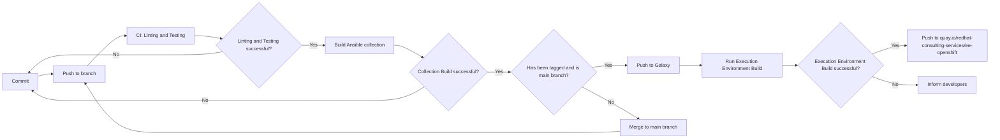

# ansible-collection-openshift

The `redhat_consulting_services.openshift` Ansible collection automates the full lifecycle of OpenShift clusters: bootstrapping and installing new clusters, adding and approving nodes, configuring node labels and taints, setting up OperatorHub and OpenShift GitOps, and mirroring images and operators to private registries for disconnected environments. Both OpenShift 4.x and 5.x are supported, and a ready-to-use Execution Environment ships the collection together with the matching `oc`, `openshift-install`, and `oc-mirror` tools.

## Roles

- **add_nodes**: A role to add nodes to an OpenShift cluster
- **approve_nodes**: A role to approve CSRs for new nodes added to an OpenShift cluster
- **bootstrap_cluster**: A role to bootstrap an OpenShift cluster
- **cluster_installation_check**: A role to check the installation status of an OpenShift cluster
- **configure_olm**: A role to configure the operator hub and add custom CatalogSources on a OpenShift cluster
- **bootstrap_gitops**: A role to install and configure OpenShift GitOps on an OpenShift cluster
- **configure_nodes**: A role to label and/or taint nodes in an OpenShift cluster
- **mirror_images**: A role to mirror OpenShift Operators and container images to a private registry

## Execution Environment

This collection includes an Ansible Execution Environment (EE) that packages the collection with all its dependencies and OpenShift CLI tools for easy deployment and usage.

### Execution Environment Images

The execution environment images are automatically built and pushed to the Quay.io Container Registry as part of the CI/CD pipeline. The images are tagged with the release version, OpenShift version, and build timestamp. The CI/CD pipeline is triggered when a new git tag is created. For the actual CI flow, please refer to the [CI Flow](#ci-flow) section below.

If you are interested in using the execution environment images, you can pull them from the Quay.io Container Registry. The images are available at:

**Quay.io Container Registry**: <https://quay.io/redhat-consulting-services/ee-openshift>

Each image is tagged with the release version, OpenShift version, and build timestamp. For example, an image built for release `v1.0.0` and OpenShift version `4.19.15` would be tagged as:

```txt
v1.0.0-ocp-4.19.15-202407221430
```

Right now, we build images for the last five minor OpenShift versions (e.g., `4.19`, `4.20`, `4.21`, `4.22`, and `5.0`), each with the last five patch versions (e.g., `4.22.20`, `4.22.21`, `4.22.22`, `4.22.23`, and `4.22.24`). For example, if the latest patch version for the `4.22` minor version is `4.22.24`, the following image tags would be created:

```txt
v1.0.0-ocp-4.22.20-202611111111
v1.0.0-ocp-4.22.21-202611111111
v1.0.0-ocp-4.22.22-202611111111
v1.0.0-ocp-4.22.23-202611111111
v1.0.0-ocp-4.22.24-202611111111
```

Even though OpenShift 5.x is not an actual minor release but a major release, we count it as a minor release for the sake of automation and versioning. The latest patch version for OpenShift 5.x is `5.0.3`, so the following image tag would be created:

```txt
v1.0.0-ocp-5.0.0-202611111111
v1.0.0-ocp-5.0.1-202611111111
v1.0.0-ocp-5.0.2-202611111111
v1.0.0-ocp-5.0.3-202611111111
```

### Adding New OpenShift Versions

OpenShift versions are managed via the `scripts/versions-extract.py` script, which extracts the latest versions from `mirror.openshift.com` and updates the `.github/openshift-versions.json` file. The GitHub Actions workflow `.github/workflows/update-version-matrix.yaml` runs this script to keep the version matrix up to date (currently once a week). Manual updates to the JSON are not recommended, as they will be overwritten by the script.

### What's Included

Each execution environment includes:

- **Ansible Collection**: `redhat_consulting_services.openshift`
- **OpenShift CLI Tools**:
  - `oc` - OpenShift command-line interface
  - `openshift-install` - Cluster installation tool
  - `oc-mirror` - Registry mirroring tool
- **Python Dependencies**: All required Python packages
- **Ansible Collections**: `community.general`, `kubernetes.core`

### Developing Locally

To develop the collection and execution environment locally, ensure you have the following prerequisites installed:

- **Ansible**: Version 2.21 or later
- **Ansible Builder**: Version 3.1.0 or later
- **Ansible Navigator**: Version 24.2.0 or later
- **Podman Engine**: Version 5.5.0 or later
- **Python**: Version 3.14 or later
- **yq**: Version 4.53.0 or later

Other versions may work, but these are the versions we have tested and verified.

#### Building the Collection

To build the collection locally, we provide a helper Makefile target, which you can use to build the collection with the following command:

```bash
make build-collection
```

This command will create a `.tar.gz` file in the `colections/` directory, with the name `redhat_consulting_services-openshift-0.0.0-rc.0.tar.gz`.

If you want to adjust the version locally, you can export the variable `EE_VERSION`. This variable is referenced as part of the build process in the `Makefile`. For example, to build a collection with version `1.0.0`, you can run:

```bash
export EE_VERSION=1.0.0
make build-collection
```

#### Building the Execution Environment

To build the execution environment locally, we also provide a helper Makefile target. You can use the following command to build the execution environment:

```bash
make build-execution-environment
```

The execution environment is built using Podman and may not be compatible with all systems. `EE_VERSION` is referenced as part of the build process in the `Makefile`. You can adjust the version locally by exporting the variable `EE_VERSION` before running the build command. Keep in mind, that the collection has to be built first, as the execution environment build process depends on the collection artifact.

By default, unless changed, the execution environment build will use OpenShift version `5.0.3` as the referenced OpenShift version. You can adjust the OpenShift version by exporting the variable `OPENSHIFT_VERSION` before running the build command. For example, to build an execution environment with OpenShift version `4.22.24`, you can run:

```bash
export OPENSHIFT_VERSION=4.22.24
make build-execution-environment
```

To build the collection and execution environment in one step, you can run:

```bash
make all
```

> **Disclaimer**
> For OpenShift 5.x, the build uses the latest RHEL 9 AMD64 `oc-mirror` download rather than a version-pinned archive.

### Usage

Instructions on how to use the execution environment and the collection can be found in the [examples/dell_hardware](./examples/dell_hardware/README.md) directory.

## CI Flow


